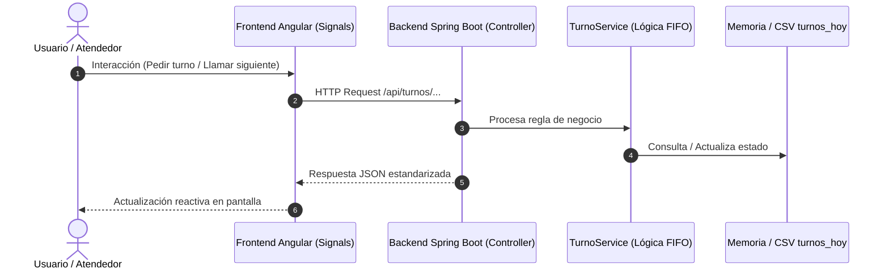

> **Módulo:** <[BACKEND-CORE] | [BACKEND-API] | [FRONTEND-USER] | [FRONTEND-DESK] | [QA-AUTOMATION]> · **Responsable:** <@integrante> · **Depende de:** <#issue o "ninguna">

---

## 1. Objetivo & Alcance de la Tarea

<!-- 
Describe de manera clara y directa qué debe construir el responsable asignado.
Explica qué parte del flujo de la 'Fila Virtual' resuelve esta tarea.
-->
- **Objetivo:** 
- **Entregable Principal:** 

---

## 2. Historia de Usuario o Rol Vinculado

<!-- Marca la historia que impacta esta tarea -->
- [ ] **📱 HU-01 (Usuario Móvil):** Pedir turno desde celular, ver cuánto falta (posición y tiempo estimado) y opción de cancelar turno.
- [ ] **💻 HU-02 (Atendedor Ventanilla):** Llamar turnos en orden FIFO y ver personas esperando en tiempo real.
- [ ] **⚙️ Infraestructura / Transversal:** Ingesta de datos CSV, pruebas automatizadas o configuración del pipeline.

---

## 3. Diagrama de Flujo / Interacción



---

## 4. Requerimientos Técnicos & Reglas de Negocio a Respetar

<!-- Puntos obligatorios para garantizar la coherencia entre los 5 desarrolladores -->
- [ ] **Rango de Turnos:** Secuencial del `1` al `999`.
- [ ] **Identificador Único:** Usar ID interno único para no colisionar con números repetidos (ej. turno `#7` del CSV).
- [ ] **Prioridad FIFO:** Ordenar la cola de pendientes estrictamente por `hora_solicitud` ascendente.
- [ ] **Nulos en Tiempo:** Manejar de forma segura `hora_atencion` vacía sin lanzar excepciones.
- [ ] **Tokens de UI (Si aplica al Frontend):** Respetar la paleta *Modern FinTech Aurora* (Índigo `#4F46E5`, Ámbar `#CA8A04`, Zinc `#18181B`).

---

## 5. Criterios de Aceptación (Gherkin BDD)

<!-- El responsable debe verificar estos escenarios antes de solicitar el PR -->

- [ ] **[CP-POS] Happy Path:**
  - **Dado que** <el sistema se encuentra en estado válido>
  - **Cuando** <el usuario o servicio ejecuta la acción esperada>
  - **Entonces** <el resultado es exitoso, actualiza el estado y retorna respuesta HTTP esperada en < 300ms>

- [ ] **[CP-NEG] Validación / Caso Borde:**
  - **Dado que** <un estado no permitido (ej. llamar turno cuando no hay personas en espera, o CSV corrupto)>
  - **Cuando** <se intenta procesar la petición>
  - **Entonces** <el sistema responde con error controlado sin tumbar la aplicación>

---

## 6. Comandos de Verificación Local

<!-- Comandos que el integrante debe correr y verificar en verde -->

```powershell
# Si la tarea es de Backend:
./mvnw clean test

# Si la tarea es de Frontend:
ng test
ng build

# Si la tarea es de Pruebas de API:
postman collection run ./turnos_collection.json

# Si la tarea es de Selenium:
./mvnw test -Dtest=*SeleniumTest*
```

---

## 7. Definition of Done (DoD) para Aprobación del PR

- [ ] Rama creada bajo la convención: `feat/modulo-descripcion-corta`.
- [ ] Commits respetan **Conventional Commits** (`feat(scope): mensaje`).
- [ ] El código compila localmente sin advertencias críticas.
- [ ] Pruebas unitarias o de integración asociadas en verde.
- [ ] PR abierto hacia la rama principal usando [PULL_REQUEST_TEMPLATE.md](../PULL_REQUEST_TEMPLATE.md).
