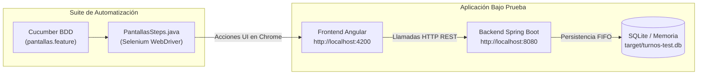

# 🧪 Guía de Pruebas End-to-End con Selenium & Cucumber

> **Proyecto:** Fila Virtual de Turnos (Eliminar Filas Físicas)  
> **Módulo:** QA Automation & End-to-End Testing  
> **Tecnologías:** Selenium WebDriver 4 · Cucumber BDD (Gherkin en Español) · Google Chrome · AssertJ  
> **Fecha:** 29 de Octubre de 2026  

---

## 1. Arquitectura de las Pruebas E2E

Las pruebas de interfaz automatizan el comportamiento real del usuario final y del operador de ventanilla interactuando con la aplicación web en Google Chrome.



### Características Clave:
* **Selenium Manager Integrado:** No requiere descargar ni configurar binarios de `chromedriver.exe` manualmente; Selenium 4 lo resuelve en tiempo de ejecución.
* **Desacoplamiento UI (`data-testid`):** Los localizadores apuntan exclusivamente a atributos `data-testid`, permitiendo que el diseño visual, estilos CSS o jerarquías HTML cambien sin romper los tests.
* **Captura Automática de Pantallas:** Tras cada escenario (`@After("@ui")`), el framework captura y adjunta una imagen PNG al reporte de Cucumber.

---

## 2. Contrato de Selectores UI (`data-testid`)

Para garantizar que las pruebas pasen en verde, los componentes del Frontend en Angular deben implementar los siguientes identificadores:

### 📱 Pantalla Móvil del Usuario (`/usuario`)
| Elemento | Selector (`data-testid`) | Tipo | Propósito |
|---|---|---|---|
| Botón Solicitar Turno | `btn-solicitar-turno` | `<button>` | Solicita un nuevo turno en la fila |
| Número de Turno Asignado | `turno-asignado` | `<span>`, `<div>` | Muestra el número asignado (ej. `11`) |
| Turnos por Delante | `turnos-por-delante` | `<span>`, `<div>` | Muestra personas antes en espera (ej. `5`) |
| Tiempo Estimado de Espera | `tiempo-estimado` | `<span>`, `<div>` | Muestra los minutos calculados (ej. `~61 min`) |
| Botón Cancelar Turno | `btn-cancelar-turno` | `<button>` | Cancela el turno activo en estado pendiente |

### 💻 Pantalla de Ventanilla del Atendedor (`/atendedor`)
| Elemento | Selector (`data-testid`) | Tipo | Propósito |
|---|---|---|---|
| Personas Esperando | `personas-esperando` | `<span>`, `<div>` | Contador de turnos en estado `pendiente` |
| Turno en Ventanilla | `turno-actual` | `<span>`, `<div>` | Número del turno atendido actualmente |
| Botón Llamar Siguiente | `btn-llamar-siguiente` | `<button>` | Despacha el siguiente turno por FIFO |
| Tabla de Turnos | `tabla-turnos` | `<table>` | Listado histórico y en vivo de los turnos |
| Fila individual de turno | `fila-turno` | `<tr>` | Fila con datos del turno (número, hora, estado) |
| Mensaje de Error / Alerta | `mensaje-error` | `<div>`, `<p>` | Feedback cuando la fila está vacía o hay conflicto |

---

## 3. Escenarios BDD Implementados (`pantallas.feature`)

Los escenarios están redactados en lenguaje Gherkin en español (`@ui`):

```gherkin
# language: es
@ui
Característica: Pantallas del usuario y del atendedor (Selenium)
  Requiere el front corriendo en http://localhost:4200 apuntando al back en el puerto 8080.

  Antecedentes:
    Dado que la fila tiene los turnos registrados en la mañana

  Escenario: El usuario pide turno desde el celular y ve cuánto le falta
    Cuando el cliente abre la pantalla para pedir turno
    Y pide un turno
    Entonces ve que le asignaron el turno 11
    Y ve que tiene 5 personas delante
    Y ve el tiempo estimado de espera

  Escenario: El atendedor ve la fila y llama al siguiente
    Cuando el asesor abre su pantalla
    Entonces ve 5 personas esperando
    Y ve la tabla con 11 turnos
    Cuando llama al siguiente turno desde la pantalla
    Entonces ve el turno 6 en ventanilla
    Y ve 4 personas esperando

  Escenario: El atendedor no puede llamar al siguiente con la fila vacía
    Dado que la fila está vacía
    Cuando el asesor abre su pantalla
    Y llama al siguiente turno desde la pantalla
    Entonces ve un mensaje de fila vacía
    Y ve 0 personas esperando
```

---

## 4. Guía de Ejecución Paso a Paso

### Paso 1: Levantar el Frontend
En una terminal independiente, asegúrate de que el frontend esté corriendo en el puerto 4200:
```powershell
cd turnos_accenture_base/frontend/turnos-frontend
npm start
# Verifica en el navegador que cargue: http://localhost:4200
```

### Paso 2: Ejecutar la Suite de Selenium
> **Nota Importante:** No es necesario tener el backend corriendo en otra consola si ejecutas las pruebas con Maven; la configuración `CucumberSpringConfig` levanta automáticamente el backend con su base de prueba aislada (`turnos-test.db`). Si ya tienes el backend arriba, detenlo para evitar colisión en el puerto 8080.

```powershell
cd turnos_accenture_base/backend

# 1. Ejecutar solo las pruebas de Selenium (con navegador visible)
./mvnw test -Dcucumber.filter.tags="@ui"

# 2. Ejecutar en modo Headless (sin abrir ventana, ideal para CI/CD)
./mvnw test -Dcucumber.filter.tags="@ui" -Dheadless=true

# 3. Personalizar la URL del frontend (si corre en otro host/puerto)
./mvnw test -Dcucumber.filter.tags="@ui" -Dfront.url=http://localhost:4200

# 4. Ejecutar todas las pruebas (API REST + Selenium E2E)
./mvnw test -Dcucumber.filter.tags="@api or @ui"
```

### Paso 3: Inspeccionar el Reporte HTML y Capturas
Al finalizar la ejecución, abre el reporte interactivo generado:
* **Ruta del reporte:** `turnos_accenture_base/backend/target/cucumber-report.html`
* Cada escenario contiene el log detallado paso a paso y la **captura de pantalla final** adjunta.

---

## 5. Resolución de Problemas Comunes (Troubleshooting)

| Síntoma | Causa Probable | Solución |
|---|---|---|
| `Port 8080 is already in use` | Había una instancia de Spring Boot corriendo previamente. | Detener el proceso con `Get-Process -Name java \| Stop-Process` o liberar el puerto 8080. |
| `ERR_CONNECTION_REFUSED (localhost:4200)` | El frontend de Angular no se encuentra iniciado. | Correr `npm start` dentro de `turnos-frontend` y verificar que responda en `http://localhost:4200`. |
| `TimeoutException: Expected condition failed: visibilityOfElementLocated` | El componente tardó en renderizar o falta el atributo `data-testid`. | Verificar en el inspector de elementos del navegador que el elemento contenga el `data-testid` exacto. |
| `SessionNotCreatedException` | Versión desactualizada de Google Chrome. | Actualizar Google Chrome a la versión más reciente; Selenium Manager descargará automáticamente el driver correspondiente. |

---

## 6. Plantilla Oficial de QA Review (Formato para PRs e Issues)

> Copia y pega esta sección en la descripción de tu Pull Request o en el Issue correspondiente para documentar la validación de calidad.

```markdown
<!-- ===================================================================== -->
<!--                       PLANTILLA DE QA REVIEW                          -->
<!-- ===================================================================== -->

# 📋 QA Review Report

- **Fecha de Evaluación:** AAAA-MM-DD
- **Responsable de QA:** @usuario
- **Rama Evaluada:** `feat/...`
- **Commit SHA:** `abcdef1`
- **Entorno de Pruebas:** Local (Windows 11 / Chrome vXXX / Angular v19+ / Spring Boot 3)

---

## 1. Matriz de Ejecución de Pruebas E2E (Selenium)

| ID Caso | Escenario Evaluado | Criterio de Aceptación | Resultado Esperado | Resultado Obtenido | Estado (PASS / FAIL) |
|:---:|---|---|---|---|:---:|
| **E2E-01** | Pedir turno móvil (`/usuario`) | HU-01 | Asigna Turno #11, 5 personas delante y tiempo calculado | Asignado #11, 5 delante, tiempo visible | [ ] PASS / [ ] FAIL |
| **E2E-02** | Llamar siguiente (`/atendedor`) | HU-02 | Llama Turno #6 en ventanilla y personas esperando bajan a 4 | Turno #6 en ventanilla, esperando: 4 | [ ] PASS / [ ] FAIL |
| **E2E-03** | Fila vacía (`/atendedor`) | Regla de Negocio | Impide llamada y muestra mensaje de fila vacía | Mensaje visible, 0 esperando | [ ] PASS / [ ] FAIL |
| **E2E-04** | Cancelación de turno (`/usuario`) | HU-01 Ext | Permite cancelar turno pendiente y recalcula la fila | Turno pasa a cancelado, cupo liberado | [ ] PASS / [ ] FAIL |

---

## 2. Checklist de Validación Visual y Responsive

- [ ] **Paleta Aurora:** Cumple con Índigo (`#4F46E5`), Zinc (`#18181B`) y badges en Ámbar/Rojo/Gris.
- [ ] **Vista Móvil (`/usuario`):** Elementos legibles y botones accesibles en viewport móvil (375x667 o 390x844).
- [ ] **Vista Atendedor (`/atendedor`):** Dashboard y tabla de turnos clara en desktop (1280x900).
- [ ] **Reactivity:** Cambios de estado reflejados sin necesidad de recargar la página (F5).

---

## 3. Evidencias de Ejecución

### 📊 Reporte Cucumber HTML:
* **Estado:** [ ] 100% Pasado (Green) · [ ] Con Fallas
* **Ruta de Evidencia:** `backend/target/cucumber-report.html`

### 📸 Capturas de Pantalla (Screenshots):
<!-- Adjunta las capturas generadas automáticamente en el reporte o capturas manuales de los flujos -->
* **Vista Usuario:** ``
* **Vista Atendedor:** ``

---

## 4. Defectos / Hallazgos Encontrados (Si Aplica)

| ID Defecto | Severidad (Alta/Media/Baja) | Descripción del Comportamiento Anómalo | Pasos para Reproducir | Estado |
|:---:|:---:|---|---|:---:|
| **BUG-01** | *Ej. Media* | *Ej. El botón de cancelar no actualiza el tiempo en la vista usuario inmediatamente* | *1. Pedir turno 2. Cancelar* | *Abierto / Resuelto* |

---

## 5. Veredicto Final de Calidad

- [ ] **APROBADO (QA Sign-Off):** La funcionalidad cumple con todas las reglas de negocio, pasa las pruebas de Selenium en verde y está lista para ser integrada.
- [ ] **RECHAZADO (Cambios Requeridos):** Se encontraron defectos bloqueantes o fallos en los tests automatizados. Devolver al desarrollador.

**Comentarios Adicionales del Revisor:**
> *Escribe aquí observaciones sobre rendimiento, accesibilidad o sugerencias de mejora.*
```
