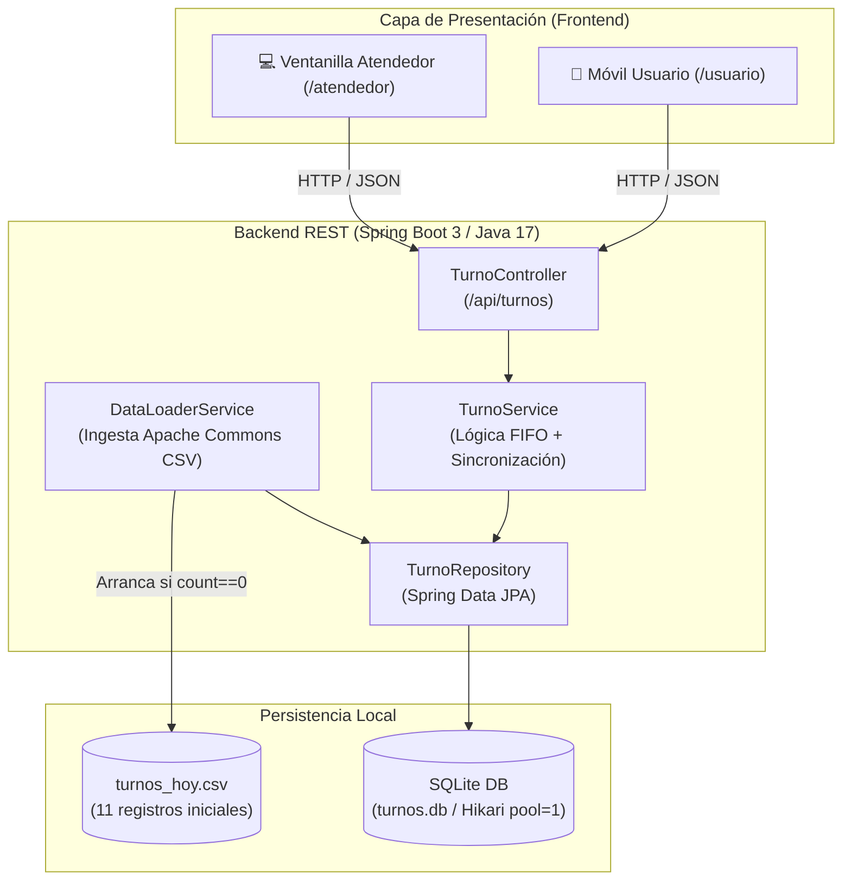
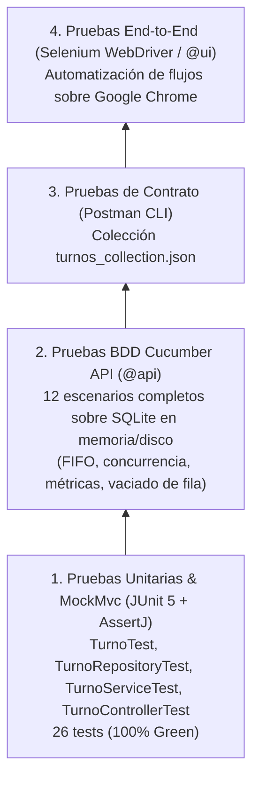

# 🏛️ Fila Virtual de Turnos (Virtual Queue Management System)

[](https://adoptium.net/)
[](https://spring.io/projects/spring-boot)
[](https://www.sqlite.org/)
[](https://angular.dev/)
[](https://cucumber.io/)
[](https://www.postman.com/)
[](LICENSE)

> Sistema de gestión de filas y turnos digitales diseñado para **eliminar las filas físicas** en oficinas de atención al ciudadano. Ofrece una experiencia de autoservicio móvil para usuarios y un panel de control en tiempo real para atendedores de ventanilla.

---

## 📌 Tabla de Contenidos
- [1. Misión del Reto & Historias de Usuario](#1-misión-del-reto--historias-de-usuario)
- [2. Arquitectura del Sistema](#2-arquitectura-del-sistema)
- [3. Reglas de Negocio & Casos Borde](#3-reglas-de-negocio--casos-borde)
- [4. Contratos de API REST](#4-contratos-de-api-rest)
- [5. Estructura del Repositorio](#5-estructura-del-repositorio)
- [6. Guía de Puesta en Marcha](#6-guía-de-puesta-en-marcha)
- [7. Estrategia de Pruebas Automatizadas](#7-estrategia-de-pruebas-automatizadas)
- [8. UI / UX: Sistema de Diseño Aurora](#8-ui--ux-sistema-de-diseño-aurora)

---

## 1. Misión del Reto & Historias de Usuario

### 📱 HU-01: Vista Usuario (Celular / Móvil)
> *"Como usuario, quiero pedir turno desde mi celular y ver cuánto falta para ser atendido."*
- **Solicitud de Turno:** Asignación secuencial (`1` al `999`).
- **Seguimiento en Vivo:**
  - Número de turno propio asignado (ej. `#11`).
  - Turno actualmente siendo atendido en ventanilla (ej. `#5`).
  - Cantidad de personas por delante en la fila (ej. `5 personas antes de ti`).
  - Tiempo estimado de espera en minutos ($5 \text{ personas} \times 12.2 \text{ min} = 61.0 \text{ min}$).
- **Cancelación de Turno:** El usuario puede cancelar su turno activo en cualquier momento mientras esté en estado `pendiente`, liberando de inmediato su posición y actualizando los tiempos de espera de los demás usuarios.

### 💻 HU-02: Vista Atendedor (Ventanilla / Oficina)
> *"Como atendedor, quiero llamar los turnos y ver cuántas personas están esperando."*
- **KPIs en Tiempo Real:** Contador destacado de *"Personas esperando en este momento"* (suma de turnos en estado `pendiente`).
- **Lamar Siguiente Turno:** Botón principal que selecciona el turno más antiguo por `hora_solicitud` (**política estricta FIFO**), registra la `hora_atencion` con la hora del sistema y cambia el estado a `atendido`.
- **Fila Vacía:** Si no hay turnos pendientes, el llamado es rechazado con código de control HTTP **409 Conflict**.
- **Tabla en Vivo:** Historial de turnos de la jornada cargados inicialmente desde `turnos_hoy.csv`.

---

## 2. Arquitectura del Sistema



---

## 3. Reglas de Negocio & Casos Borde

1. **Identificador Compuesto vs. Clave Primaria:**
   - La entidad `Turno` usa un **ID interno autoincremental (`id: Long`)** como Primary Key desacoplado del campo visible `numero`. Esto permite que el número de turno se repita a lo largo de la jornada sin violar restricciones de unicidad (ej. el turno `#7` cancelado a las 08:30 y re-solicitado a las 08:34).
2. **Prioridad FIFO Real por Hora:**
   - La cola de pendientes se atiende ordenando estrictamente por `hora_solicitud ASC`. Esto soluciona inconsistencias físicas en archivos de carga donde turnos más tardíos (como el `#9` a las 08:41) aparecen antes de turnos anteriores (como el `#7` a las 08:34).
   - Secuencia de llamado garantizada: `6 -> 7 -> 8 -> 9 -> 10`.
3. **Turnos Cancelados:**
   - Un turno cancelado **nunca es llamado** por ventanilla.
4. **Cálculo de Tiempos de Espera:**
   - $\text{Tiempo de Espera Real} = \text{hora\_atencion} - \text{hora\_solicitud}$ (para turnos atendidos).
   - Promedio de espera de la mañana: $(3 + 9 + 14 + 16 + 19) / 5 = \mathbf{12.2 \text{ min}}$.
   - $\text{Tiempo Estimado Restante} = \text{turnosPorDelante} \times \text{promedioEsperaMinutos}$.
5. **Numeración Secuencial:**
   - Del `1` al `999`. Al emitir después del 999, la numeración reinicia automáticamente en `1`.
6. **Concurrencia Segura en SQLite:**
   - HikariCP configurado con `maximum-pool-size=1` para prevenir bloqueos de archivo (`database is locked`).
   - Métodos transaccionales `synchronized` en `TurnoService` para garantizar que llamadas concurrentes de múltiples asesores devuelvan turnos distintos.

---

## 4. Contratos de API REST

Todos los endpoints se encuentran prefijados por `/api/turnos`:

| Método | Endpoint | Rol | Descripción | Código | Payload de Respuesta |
| :--- | :--- | :--- | :--- | :---: | :--- |
| `POST` | `/api/turnos/solicitar` | Móvil | Solicita un nuevo turno consecutivo | `200 OK` | `{"id": 12, "numero": 11, "horaSolicitud": "09:00:00", "estado": "pendiente", "turnosPorDelante": 5, "tiempoEstimadoMinutos": 61.0}` |
| `GET` | `/api/turnos/{numero}/estado` | Móvil | Consulta posición y cuánto falta | `200 OK` | `{"numero": 9, "estado": "pendiente", "turnoActual": 5, "turnosPorDelante": 3, "tiempoEstimadoMinutos": 36.6}` |
| `PUT` | `/api/turnos/{numero}/cancelar` | Móvil | Cancela el turno activo en espera | `200 OK` | `{"numero": 11, "estado": "cancelado", "mensaje": "Turno cancelado exitosamente"}` |
| `POST` | `/api/turnos/llamar-siguiente` | Ventanilla | Llama al siguiente turno en orden FIFO | `200 OK` | `{"id": 6, "numero": 6, "horaAtencion": "08:52:10", "estado": "atendido"}` |
| `POST` | `/api/turnos/llamar-siguiente` | Ventanilla | Fila vacía (sin turnos pendientes) | `409 Conflict` | `{"error": "Conflict", "mensaje": "No hay turnos pendientes en la fila"}` |
| `GET` | `/api/turnos/metricas-fila` | Ventanilla | KPIs de ventanilla en vivo | `200 OK` | `{"personasEsperando": 5, "totalAtendidos": 5, "totalCancelados": 1, "turnoActual": 5, "promedioEsperaMinutos": 12.2}` |
| `GET` | `/api/turnos` | Auditoría | Lista completa de todos los turnos | `200 OK` | `Array<Turno>` |

Documentación interactiva disponible en Swagger UI:  
👉 **http://localhost:8080/swagger-ui.html**

---

## 5. Estructura del Repositorio

```text
├── turnos_accenture_base/
│   ├── backend/                              # Backend Spring Boot 3
│   │   ├── .mvn/                             # Maven Wrapper embebido
│   │   ├── mvnw / mvnw.cmd                   # Scripts ejecutables de Maven
│   │   ├── pom.xml                           # Dependencias Java 17, JPA, SQLite, Cucumber
│   │   └── src/
│   │       ├── main/
│   │       │   ├── java/com/turnos/
│   │       │   │   ├── controller/           # TurnoController
│   │       │   │   ├── dto/                  # DTOs de Request y Response
│   │       │   │   ├── exception/            # FilaVaciaException, GlobalExceptionHandler
│   │       │   │   ├── model/                # Entidad Turno, LocalTimeStringConverter
│   │       │   │   ├── repository/           # TurnoRepository
│   │       │   │   └── service/              # TurnoService, DataLoaderService
│   │       │   └── resources/
│   │       │       ├── application.properties
│   │       │       └── data/turnos_hoy.csv   # Dataset matutino de prueba
│   │       └── test/
│   │           ├── java/com/turnos/          # Pruebas unitarias JUnit 5 y QA Cucumber
│   │           └── resources/features/       # Escenarios BDD fila_turnos.feature
│   ├── frontend/turnos-frontend/             # Aplicación Angular Standalone
│   └── turnos_collection.json                # Suite Postman para Postman CLI
├── WORKFLOW_SPEC.md                          # Blueprint técnico y especificación del caso
├── GEMINI.md / CLAUDE.md                     # Guías para asistentes y desarrolladores
└── README.md                                 # Documentación principal
```

---

## 6. Guía de Puesta en Marcha

### Prerrequisitos
- **Java:** JDK 17 o superior.
- **Node.js:** v20+ y npm.
- **Google Chrome:** Para pruebas de automatización E2E.

### 1. Iniciar el Backend
```powershell
cd turnos_accenture_base/backend

# Ejecución del servidor (puerto 8080)
./mvnw clean spring-boot:run
```

### 2. Iniciar el Frontend (Angular)
```powershell
cd turnos_accenture_base/frontend/turnos-frontend

# Instalación de dependencias y arranque
npm install
npm start
# Aplicación disponible en http://localhost:4200
```

---

## 7. Estrategia de Pruebas Automatizadas

El proyecto implementa la **Pirámide de Pruebas**:



### Ejecutar Pruebas del Backend
```powershell
cd turnos_accenture_base/backend

# Ejecutar suite de pruebas unitarias y BDD de Cucumber
./mvnw test

# Reporte interactivo generado en:
# target/cucumber-report.html
```

### Ejecutar Pruebas de API con Postman CLI
Con el backend en ejecución (`localhost:8080`):
```powershell
postman collection run ./turnos_accenture_base/turnos_collection.json
```

### Ejecutar Pruebas E2E de Selenium
Con frontend y backend en ejecución:
```powershell
cd turnos_accenture_base/backend
./mvnw test -Dcucumber.filter.tags="@ui"
```

---

## 8. UI / UX: Sistema de Diseño Aurora

El frontend implementa la paleta *Modern FinTech Aurora*:
- **Fondo:** `#FAFAFC`
- **Primario / Acción:** Índigo `#4F46E5` (Hover: `#4338CA`)
- **Texto Principal:** Zinc 900 `#18181B` | **Secundario:** Zinc 500 `#71717A`
- **Badges Semánticos:**
  - `pendiente`: Ámbar (`#CA8A04` sobre `#FEFCE8`)
  - `atendido`: Zinc (`#52525B` sobre `#F4F4F5`)
  - `cancelado`: Rojo (`#DC2626` sobre `#FEF2F2`)

---

## 👥 Equipo & Entrega
- **Candidato / Desarrollador:** Alan Moreno  
- **Proyecto:** Reto Técnico Accenture — Fila Virtual de Turnos  
- **Fecha:** Octubre de 2026
